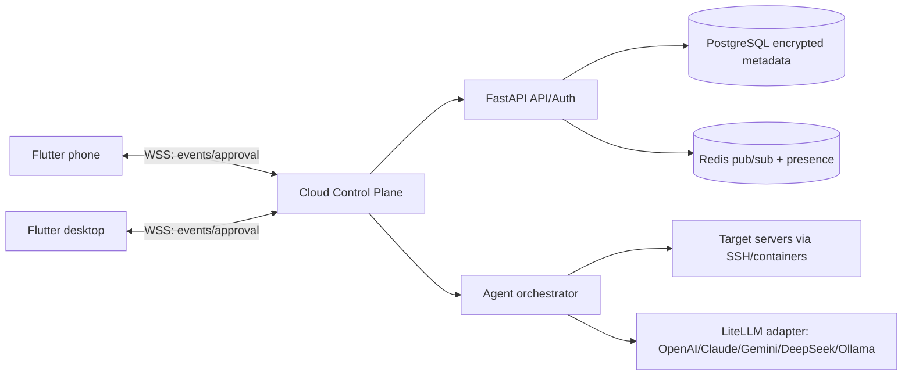

# OmniCodex architecture

## Cloud–PC–phone topology



Clients never connect to target servers. The cloud control plane is the sole execution gateway, so a phone can operate a server while the PC is offline.

## Core tables

```sql
create table app_user (id uuid primary key, email text unique not null, key_version int not null default 1, created_at timestamptz not null default now());
create table project (id uuid primary key, user_id uuid not null references app_user(id), name text not null, snapshot_ciphertext bytea not null, snapshot_version bigint not null default 1, updated_at timestamptz not null default now());
create table device_session (id uuid primary key, user_id uuid not null references app_user(id), device_id text not null, platform text not null, refresh_token_hash text not null, last_seen_at timestamptz not null);
create table conversation_event (id bigserial primary key, project_id uuid not null references project(id), actor text not null, event_type text not null, payload_ciphertext bytea not null, seq bigint not null, created_at timestamptz not null default now());
create table approval (id uuid primary key, project_id uuid not null references project(id), command_hash text not null, status text not null, decided_by uuid references app_user(id), expires_at timestamptz not null);
create index project_user_idx on project(user_id); create index event_project_seq_idx on conversation_event(project_id, seq);
```

Encrypt snapshots, event payloads and SSH private keys with envelope encryption (KMS-wrapped per-user data key). Redis stores ephemeral presence, fan-out and idempotency keys; it is never the source of truth.

## New-device rehydrate

1. Device authenticates and receives a short-lived access token plus a device session.
2. Client calls `GET /v1/sync/export?since=<cursor>`; the server authorizes the user and returns a versioned manifest, project snapshots, event tail, environment metadata and UI layout. Secrets are returned only as encrypted envelopes.
3. Client verifies manifest hash/signature, decrypts only in the platform keystore, persists an encrypted cache, and atomically replaces its in-memory store.
4. Client replays events by sequence, rebuilds the workspace, opens a WebSocket, sends `sync.ready`, then applies live events. Reconnect uses the last acknowledged cursor.
5. Approval events are idempotent (`approval_id` + version); the first valid approval wins and is broadcast to every connected device.

